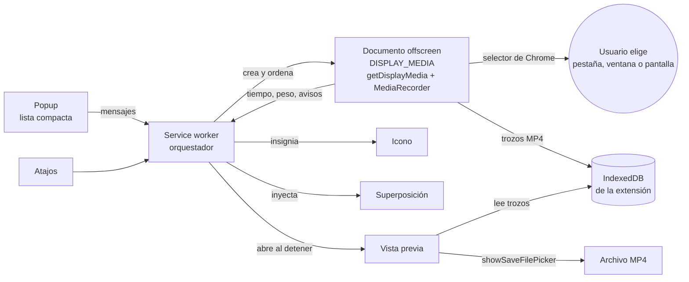

# Grabador MP4 para Chrome: especificación

**Estado:** v2, revisada tras la Fase 1 · 1 de noviembre de 2026
**Origen:** decisiones confirmadas en la página de la Fase 0 (https://claude.ai/artifact/MsHTrfhhM28DQN4mnWXwoy), la aclaración sobre el guardado, el diagnóstico de la Fase 1 (`docs/fase1-diagnostico.md`) y dos decisiones posteriores: la pestaña se elige en el selector de Chrome y Linux queda fuera.
**Marcas:** **[F3]** = no se puede comprobar sin un Windows o un Mac reales; se verifica en la Fase 3 con la checklist.

### Cambios respecto a la v1

| v1 | v2 | Motivo |
|---|---|---|
| Pestaña sin selector con `tabCapture` | Pestaña elegida en el selector de Chrome | `tabCapture` hace que Chrome avise al instalar de «leer y cambiar todos tus datos de todos los sitios web» |
| Ventana/pantalla con `desktopCapture` desde el service worker | `getDisplayMedia()` dentro del offscreen (motivo `DISPLAY_MEDIA`) para las tres fuentes | `desktopCapture` no funciona desde el service worker y su id no vale en el offscreen (Fase 1 §1) |
| Pedir la resolución con `maxWidth/maxHeight` altos | No pedir tamaño; leer `getSettings()` | Con máximos altos Chrome agranda la imagen (Fase 1 §4) |
| Reenviar el audio de la pestaña a los altavoces | No hace falta | Con `getDisplayMedia` la pestaña sigue sonando **[F3]** |
| Cualquier sistema | Windows y macOS | En Linux Chrome no codifica AAC (Fase 1 §2) |
| Permisos `tabCapture`, `desktopCapture` | Fuera | Ya no se usan; la extensión se instala sin ningún aviso |

---

## 1. Qué es

Una extensión de Chrome (Manifest V3) que graba una pestaña, una ventana o la pantalla completa a un archivo **MP4 (H.264 + AAC)**, a la **resolución nativa** de lo que se graba, con audio opcional de la pestaña o del sistema. Uso interno de Dipesa, en **Windows y macOS**, Chrome 126 o posterior. No se publica en Chrome Web Store.

**Criterio de éxito:** un MP4 que se abre en QuickTime, VLC y el reproductor de Windows, con la resolución física de la pantalla, ventana o pestaña grabada (comprobada con `ffprobe`), con sonido cuando se ha pedido y está disponible, y sin perder lo grabado si algo falla a mitad.

## 2. Decisiones

| Tema | Decisión |
|---|---|
| Ubicación del código | Repositorio `strato88/chrome-recorder` |
| Sistemas | Windows y macOS. En Linux la extensión dice que no está soportada y no graba |
| Identidad visual | Imagen de Dipesa: azul `#2E86AB`, Outfit + JetBrains Mono empaquetadas, rojo solo para «grabando», claro y oscuro |
| Fuentes | Pestaña · Ventana · Pantalla completa, **todas a través del selector de Chrome** |
| Audio | Sin audio, o audio de la pestaña / del sistema. Sin micrófono ni mezcla |
| Resolución | Nativa, con tope del codificador (reduce manteniendo proporción y avisa) |
| Fotogramas | Se eligen en el popup: 30 (por defecto) o 60 |
| Calidad | Normal (por defecto), Alta, Máxima |
| Formato | MP4 nativo de Chrome (`MediaRecorder`), sin conversión |
| Acumulación | En el disco, por trozos, dentro de la extensión (recuperable) |
| Duración máxima | 1 hora: aviso a los 55 min, parada a los 60 |
| Cuenta atrás | 3 segundos, cancelable |
| Pausa | Sí |
| Al detener | Vista previa; «Guardar» abre Guardar como; «Descartar» lo borra |
| Nombre del archivo | `Titulo-de-la-pestana_AAAA-MM-DD_HH-MM.mp4` |
| Atajos | `Alt+Mayús+R` iniciar o detener · `Alt+Mayús+P` pausar o reanudar |
| Popup | Lista compacta (desplegables) |
| Indicador | Insignia en el icono + temporizador en el popup + superposición en la página |
| Idioma | Castellano (textos en `_locales/es`) |

Quedan fuera: Linux, micrófono, mezcla de audios, cámara, edición, subida a la nube y publicación en la tienda.

## 3. Arquitectura



**Por qué así.** El documento offscreen abre el selector, recibe la captura y graba; no depende del popup (que se cierra al hacer clic fuera) y no deja ninguna ventana a la vista. Una sola forma de capturar para las tres fuentes. El service worker solo coordina y puede dormirse sin cortar la grabación. Los trozos van al disco.

**Reserva [F3]:** en la Fase 1 el selector se eligió solo (opción de pruebas de Chrome). Con una persona eligiendo, hay que confirmar que Chrome no exige una «activación por el usuario» que el offscreen no tiene. Si la exigiera, el plan B probado es abrir una ventanita de la extensión que abre el selector y graba ella misma; el resto del diseño no cambia.

### 3.1 Piezas

| Pieza | Fichero(s) | Hace | No hace |
|---|---|---|---|
| Manifiesto | `manifest.json` | Permisos, atajos, idioma por defecto `es`, `minimum_chrome_version` 126 | — |
| Orquestador | `background/service-worker.js` + `background/estado.js` | Máquina de estados, insignia, atajos, crear y cerrar el offscreen, inyectar la superposición, abrir la vista previa, recuperar grabaciones huérfanas | Tocar `MediaStream` |
| Grabadora | `offscreen/grabadora.html` + `offscreen/grabadora.js` | `getDisplayMedia`, comprobar resolución, tope y vigilante, `MediaRecorder`, escribir trozos, detectar fin de captura | Interfaz (es invisible) |
| Almacén | `comun/almacen.js` | IndexedDB: sesiones y trozos, espacio libre, borrar | — |
| Popup | `popup/` | Configurar y lanzar; mientras graba: tiempo, peso, Pausa, Detener | Grabar |
| Superposición | `superposicion/superposicion.js` | Cuenta atrás grande, pastilla con tiempo, Pausa, Detener, Ocultar | Nada fuera de su shadow root |
| Vista previa | `vista/` | Reproducir; resolución real, duración, peso; Guardar como; Descartar con confirmación | — |
| Comunes | `comun/config.js`, `nombre.js`, `calidad.js`, `codec.js`, `mensajes.js` | Valores por defecto, nombre de archivo, bitrate y tope, elección del códec, tipos de mensaje | — |
| Estilo | `comun/estilo.css`, `fuentes/` | Tokens de color y letra, claro y oscuro | — |
| Textos | `_locales/es/messages.json` | Todos los textos visibles | — |

Los módulos puros (`nombre.js`, `calidad.js`, `codec.js`, la tabla de transiciones de `estado.js`) se prueban sin Chrome.

### 3.2 Máquina de estados

```
inactivo → eligiendo → cuenta_atras → grabando ⇄ en_pausa → cerrando → vista_previa → inactivo
               ↘ (cancelado) inactivo    ↘ (cancelado) inactivo
```

- Estado en `chrome.storage.session` (sobrevive a que Chrome duerma el service worker).
- Una sola grabación a la vez. «Grabar» o el atajo durante una grabación equivale a Detener.
- Las transiciones están en una tabla; una no prevista se registra y se ignora.

### 3.3 Flujo de una grabación

1. **Popup** (o `Alt+Mayús+R` con la última configuración): fuente preferida, audio, calidad y fps. Se guarda el título de la pestaña activa (para el nombre del archivo) y su id (para la superposición).
2. **Offscreen**: el orquestador lo crea con el motivo `DISPLAY_MEDIA` y le pide empezar.
3. **Selector**: `getDisplayMedia({video: {displaySurface: 'browser'|'window'|'monitor', frameRate}, audio, systemAudio: 'include', windowAudio: 'system', selfBrowserSurface: 'exclude', surfaceSwitching: 'exclude'})`. `displaySurface` solo preselecciona la pestaña del selector; el usuario puede elegir otra cosa y se graba lo que elija. Si cancela (`NotAllowedError`) → «Grabación cancelada», vuelta a inactivo.
4. **Resolución** (§4.1) y **audio**: si se pidió audio y no hay pista, aviso «Grabando sin sonido: Chrome no da el audio de esta fuente en tu sistema» y se sigue.
5. **Códec** (§4.2). Si no hay ninguno aceptable, mensaje y no se graba.
6. **Cuenta atrás de 3 s** con la captura ya abierta: insignia «3», «2», «1» y número grande en la superposición. Cancelable.
7. **Grabación**: `MediaRecorder` con `timeslice` de 2 s; cada trozo (un fragmento MP4 completo) se escribe en IndexedDB con su número de orden. Vigilante: si en 5 s no llega el primer trozo, se para y se reintenta a menor tamaño (§4.1).
8. **Durante**: insignia con el tiempo; popup y superposición con tiempo y peso. A los 55 min, aviso; a los 60, parada.
9. **Detener** (botón, atajo, «Dejar de compartir» de Chrome, pestaña o ventana grabada cerrada → evento `ended`): `recorder.stop()`, último trozo, `liberar()` (§6) y cierre del offscreen.
10. **Vista previa** en pestaña nueva: vídeo, resolución real, duración, peso, avisos (reducida, sin audio). **Guardar** → Guardar como con el nombre propuesto; escritos todos los trozos, se borran. **Descartar** → confirmación en la página y se borran.

## 4. Reglas de detalle

### 4.1 Resolución y tope

- **No se pide tamaño.** Sin restricciones Chrome entrega los píxeles físicos (Fase 1 §4). Se lee siempre `getSettings()`.
- **Tope:** 36 864 macrobloques por fotograma (≈ 9,4 M píxeles, p. ej. 4096×2304; H.264 nivel 5.1/5.2). Por encima (5K) se reduce con `applyConstraints` al mayor tamaño que quepa, proporción mantenida, dimensiones pares, y se avisa. **[F3]** comprobar en Windows y macOS si el codificador del sistema admite más; si lo admite, el tope sube.
- **Vigilante:** sin primer trozo en 5 s → parar y reintentar una vez a 1920 px de ancho como máximo; si vuelve a fallar, mensaje y fin.
- **Redimensionar la ventana grabada:** **[F3]** ver qué hace Chrome; lo deseado es mantener el tamaño inicial del vídeo con el contenido escalado.

### 4.2 Códec

Se prueban con `MediaRecorder.isTypeSupported()`, en este orden, y se usa el primero aceptado:
`video/mp4;codecs="avc1.640034,mp4a.40.2"` → `avc1.4D0034` → `avc1.42E034` → `video/mp4;codecs="avc1,mp4a.40.2"`.
Sin audio, los mismos sin `mp4a.40.2`. Si ninguno se acepta: en Linux, «Esta extensión funciona en Windows y macOS»; en otro sistema, «Hace falta Chrome 126 o posterior». Nunca se graba en otro formato a escondidas. **[F3]** confirmar AAC en Windows y macOS.

### 4.3 Calidad

Bitrate de vídeo = ancho × alto × fps × factor (0,07 Normal · 0,10 Alta · 0,15 Máxima). Audio AAC 128 kbps. Referencias (Normal, 30 fps): 1080p ≈ 4,4 Mbps; 1440p ≈ 7,7 Mbps (≈ 3,5 GB/h); 4K ≈ 17 Mbps.

### 4.4 Espacio en disco

- `unlimitedStorage` (quita el tope de IndexedDB; sin aviso al instalar).
- Antes de empezar, `navigator.storage.estimate()` contra una hora a la calidad elegida; si no cabe, aviso con la duración que sí cabe, y se deja grabar.
- Escritura fallida por espacio → se detiene y pasa a la vista previa con lo grabado.

### 4.5 Recuperación

Al despertar el service worker, una sesión en IndexedDB que no está grabando ni en vista previa se abre en la vista previa como «Grabación recuperada». Comprobado en la Fase 1: un MP4 sin su último trozo es válido.

### 4.6 Nombre del archivo

`{titulo}_{AAAA-MM-DD}_{HH-MM}.mp4`

- `{titulo}`: si se grabó una **pestaña**, el título de la pestaña activa al pulsar Grabar (Chrome no dice el título de la pestaña elegida en el selector; si se eligió otra, se corrige en Guardar como). Si se grabó una **ventana** o la **pantalla** (según `displaySurface` de la captura), «Ventana» o «Pantalla».
- Limpieza: sin tildes ni diacríticos; espacios y `\ / : * ? " < > |` → `-`; guiones repetidos reducidos; máximo 80 caracteres en el título; si queda vacío, «Grabacion».
- Fecha y hora locales del inicio de la grabación.

### 4.7 Guardado

`showSaveFilePicker` desde la vista previa (existe en páginas de la extensión, Fase 1 §6), escribiendo los trozos uno a uno. Sin permiso `downloads`. **[F3]** abrir el diálogo con una persona.

### 4.8 Atajos

`chrome.commands`: `alternar-grabacion` (`Alt+Shift+R`) y `alternar-pausa` (`Alt+Shift+P`). Solo con Chrome en primer plano; se cambian en `chrome://extensions/shortcuts`. Iniciar con el atajo abre el selector con la fuente preferida guardada.

### 4.9 Superposición

- Se inyecta con `chrome.scripting` en la pestaña que estaba activa al pulsar Grabar (`activeTab`, sin acceso a todas las webs).
- Número grande durante la cuenta atrás; después, pastilla arrastrable con punto rojo, tiempo, Pausa, Detener y Ocultar. Shadow DOM cerrado.
- Sale en el vídeo si esa pestaña está a la vista en lo grabado: por eso «Ocultar».
- No se puede poner en páginas internas de Chrome ni en la tienda; si se navega a otra web, desaparece. La insignia sigue siempre.

### 4.10 Popup (lista compacta)

- **Parado:** Fuente (Pestaña / Ventana / Pantalla; texto de ayuda: «la eliges en el selector de Chrome») · Audio (Sin audio / Pestaña o sistema) · Calidad · fps · **Grabar** · línea con el peso estimado por minuto a la resolución de la pantalla.
- **Grabando:** tiempo, peso, resolución real, aviso si no hay audio, **Pausa**, **Detener**.
- Última configuración en `chrome.storage.local`.

### 4.11 Insignia

Rojo con `mm:ss`; ámbar con `II` en pausa; número en la cuenta atrás; vacía en reposo.

## 5. Permisos

| Permiso | Para qué | Aviso al instalar |
|---|---|---|
| `offscreen` | Documento invisible que abre el selector y graba | Ninguno |
| `activeTab` | Superposición y título de la pestaña activa, solo al pulsar Grabar o el atajo | Ninguno |
| `scripting` | Inyectar la superposición | Ninguno |
| `storage` | Configuración y estado de la grabación | Ninguno |
| `unlimitedStorage` | Grabaciones de hasta una hora en el disco | Ninguno |

Sin permisos de host, sin `tabCapture`, sin `desktopCapture`, sin `downloads`. **La extensión se instala sin ningún aviso de permisos** (según la lista oficial). Política de seguridad por defecto de MV3; sin código remoto, sin WebAssembly, sin dependencias.

## 6. Errores

| Situación | Qué ve el usuario | Qué hace la extensión |
|---|---|---|
| Cancela el selector | «Grabación cancelada» | Vuelve a reposo |
| Linux | «Esta extensión funciona en Windows y macOS» | No graba |
| Chrome < 126 | No se instala (`minimum_chrome_version`) | — |
| Ningún códec aceptado | «No se puede grabar en MP4 en este Chrome» | No graba |
| Cierra lo grabado o pulsa «Dejar de compartir» | Vista previa con lo grabado | Detiene y libera |
| Pidió audio y no llegó | Aviso en popup, superposición y vista previa | Graba sin sonido |
| Resolución sobre el tope | Aviso en la vista previa con ambas resoluciones | Reduce |
| Vigilante: no sale nada en 5 s | «No se ha podido grabar a esta resolución; reintentando más pequeño» | §4.1 |
| Sin espacio | «Te has quedado sin espacio; se ha guardado hasta aquí» | Detiene, vista previa |
| Error de `MediaRecorder` | «La grabación se ha cortado» | Conserva trozos, vista previa |
| Chrome se cierra grabando | «Grabación recuperada» al volver | §4.5 |
| Guardar como cancelado | Nada; sigue en la vista previa | Conserva trozos |
| Selector exige activación del usuario | — | Plan B de §3 **[F3]** |

**Liberar siempre:** una única función `liberar()` (todas las pistas con `track.stop()`, `URL.revokeObjectURL` de lo creado, cierre del offscreen), llamada desde todos los caminos de salida, errores incluidos.

## 7. Pruebas

- **Automáticas (Node, sin Chrome):** nombre de archivo, bitrate y tope, elección de códec, tabla de transiciones.
- **De integración (Chrome for Testing + Xvfb, como en la Fase 1):** flujo completo con selección automática: grabar 5 s de pantalla y de pestaña, comprobar con `ffprobe` resolución y pistas, y la recuperación sin el último trozo. Linux no tiene AAC, así que aquí se comprueba con Opus forzado solo en modo de prueba.
- **Manuales (Fase 3):** cada fuente × cada modo de audio en Windows y macOS, con la checklist, la carga en `chrome://extensions` y:
  `ffprobe -v error -select_streams v:0 -show_entries stream=codec_name,profile,width,height,r_frame_rate -show_entries format=duration -of default=nw=1 archivo.mp4`

## 8. Pendiente de la Fase 3 (máquinas reales)

1. El selector abierto desde el offscreen con una persona eligiendo (sin selección automática).
2. AAC en Windows y macOS con `isTypeSupported`.
3. QuickTime y reproductor de Windows con el MP4 fragmentado (y los avisos de marcas de tiempo de la Fase 1 §2).
4. Tope real del codificador del sistema (pantallas 5K).
5. Audio del sistema con ventana y pantalla en macOS 14.2+ y Windows; que la pestaña grabada siga sonando.
6. Redimensionar la ventana grabada.
7. Diálogo Guardar como en la vista previa.

## 9. Estructura de carpetas

```
chrome-recorder/
├── manifest.json
├── _locales/es/messages.json
├── background/    service-worker.js, estado.js
├── offscreen/     grabadora.html, grabadora.js
├── popup/         popup.html, popup.js, popup.css
├── superposicion/ superposicion.js
├── vista/         vista.html, vista.js, vista.css
├── comun/         config.js, almacen.js, nombre.js, calidad.js, codec.js, mensajes.js, estilo.css
├── fuentes/       Outfit, JetBrains Mono (woff2) + licencias OFL
├── iconos/        16, 32, 48, 128 (reposo) y variante «grabando»
├── pruebas/       unitarias (*.test.js), integración, fase1/
├── docs/          especificacion.md, fase1-diagnostico.md
└── README.md      instalación, uso y limitaciones conocidas
```
