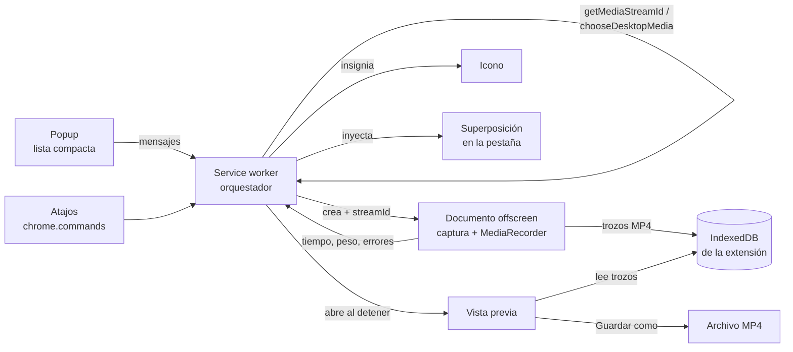

# Grabador MP4 para Chrome: especificación

**Estado:** borrador para aprobación · 1 de noviembre de 2026
**Origen:** decisiones confirmadas en la página de la Fase 0 (https://claude.ai/artifact/MsHTrfhhM28DQN4mnWXwoy) y la aclaración posterior sobre el guardado.
**Siguiente paso:** con esta especificación aprobada se hace la Fase 1 (diagnóstico técnico con fuentes oficiales). Lo marcado **[F1]** se comprueba allí y puede ajustar el diseño antes de escribir código.

---

## 1. Qué es

Una extensión de Chrome (Manifest V3) que graba una pestaña, una ventana o la pantalla completa a un archivo **MP4 (H.264 + AAC)**, a la **resolución nativa** de lo que se graba, con audio opcional de la pestaña o del sistema. Uso interno de Dipesa. No se publica en Chrome Web Store.

**Criterio de éxito:** un MP4 que se abre en QuickTime, VLC y el reproductor de Windows, con la resolución física de la pantalla o ventana grabada (comprobado con `ffprobe`), con el sonido cuando se ha pedido y está disponible, y sin perder lo grabado si algo falla a mitad.

## 2. Decisiones confirmadas

| Tema | Decisión |
|---|---|
| Ubicación del código | **Repositorio nuevo, aparte de NewFox** |
| Identidad visual | Imagen de Dipesa: azul `#2E86AB`, Outfit + JetBrains Mono empaquetadas, rojo solo para «grabando», modo claro y oscuro |
| Fuentes | Pestaña · Ventana · Pantalla completa |
| Audio | **Sin audio** o **audio de la pestaña / del sistema**. Sin micrófono y sin mezcla |
| Resolución | Nativa, con tope del codificador (reduce manteniendo proporción y avisa) |
| Fotogramas | Se eligen en el popup: 30 (por defecto) o 60 |
| Calidad | Tres niveles: Normal (por defecto), Alta, Máxima |
| Formato | MP4 nativo de Chrome (`MediaRecorder`), sin conversión |
| Acumulación | En el disco, por trozos, dentro de la extensión (recuperable si Chrome se cierra) |
| Duración máxima | **1 hora**: aviso a los 55 min, parada a los 60 |
| Cuenta atrás | 3 segundos, cancelable |
| Pausa | Sí |
| Al detener | **Vista previa; «Guardar» abre el diálogo Guardar como; «Descartar» lo borra** |
| Nombre del archivo | `Titulo-de-la-pestana_AAAA-MM-DD_HH-MM.mp4` |
| Atajos | `Alt+Mayús+R` iniciar o detener · `Alt+Mayús+P` pausar o reanudar |
| Popup | C · Lista compacta (desplegables) |
| Indicador | Insignia en el icono + temporizador en el popup + **superposición en la página** |
| Idioma | Solo castellano (textos en `_locales/es`, para poder traducir después) |

Quedan fuera: micrófono, mezcla de audios, cámara, edición, subida a la nube y publicación en la tienda.

## 3. Arquitectura



**Por qué así.** La grabación vive en un documento offscreen: no depende de que el popup siga abierto (se cierra al hacer clic fuera) y no deja una pestaña de grabadora a la vista. El service worker solo coordina y puede dormirse sin cortar la grabación. Los trozos van al disco, así que una hora a 4K no llena la memoria.

### 3.1 Piezas

| Pieza | Fichero(s) | Hace | No hace |
|---|---|---|---|
| Manifiesto | `manifest.json` | Permisos, atajos, idioma por defecto `es` | — |
| Orquestador | `background/service-worker.js` + `background/estado.js` | Máquina de estados, insignia, atajos, ids de captura, crear y cerrar el offscreen, inyectar la superposición, abrir la vista previa, recuperar grabaciones huérfanas | Tocar `MediaStream` (no puede) |
| Grabadora | `offscreen/grabadora.html` + `offscreen/grabadora.js` | `getUserMedia` con el id, comprobar resolución, aplicar tope, reenviar audio de pestaña, `MediaRecorder`, escribir trozos, detectar fin de pista | Interfaz (es invisible) |
| Almacén | `comun/almacen.js` | IndexedDB: sesiones y trozos, espacio libre, borrar | — |
| Popup | `popup/popup.html` + `.js` + `.css` | Configurar y lanzar; mientras graba: tiempo, peso, Pausa, Detener | Grabar |
| Superposición | `superposicion/superposicion.js` (+ CSS en shadow DOM) | Cuenta atrás grande, pastilla con tiempo, Pausa, Detener, Ocultar | Nada fuera de su shadow root |
| Vista previa | `vista/vista.html` + `.js` + `.css` | Reproducir, enseñar resolución real, duración, peso; Guardar como; Descartar con confirmación | — |
| Comunes | `comun/config.js`, `comun/nombre.js`, `comun/calidad.js`, `comun/mensajes.js` | Valores por defecto, nombre de archivo, cálculo de bitrate, tipos de mensaje | — |
| Estilo | `comun/estilo.css`, `fuentes/` (woff2 + licencias OFL) | Tokens de color y letra, claro y oscuro | — |
| Textos | `_locales/es/messages.json` | Todos los textos visibles | — |

Cada fichero hace una cosa y se entiende sin leer los demás; los módulos puros (`nombre.js`, `calidad.js`, la tabla de transiciones de `estado.js`) se prueban sin Chrome.

### 3.2 Máquina de estados (en el orquestador)

```
inactivo → eligiendo → cuenta_atras → grabando ⇄ en_pausa → cerrando → vista_previa → inactivo
                ↘ (cancelado) inactivo      ↘ (cancelado) inactivo
```

- El estado vive en `chrome.storage.session` para sobrevivir a que Chrome duerma el service worker.
- Solo una grabación a la vez. Pulsar «Grabar» o el atajo con una grabación en curso equivale a Detener.
- Cada transición está en una tabla; una transición no prevista se registra y se ignora.

### 3.3 Flujo de una grabación

1. **Popup** (o `Alt+Mayús+R`, con la última configuración guardada): fuente, audio, calidad y fps.
2. **Id de captura**:
   - Pestaña: `chrome.tabCapture.getMediaStreamId({targetTabId})` sobre la pestaña activa, sin selector.
   - Ventana o pantalla: `chrome.desktopCapture.chooseDesktopMedia(['window'|'screen', 'audio'?])`. Si el usuario cancela, el id llega vacío → «Grabación cancelada», vuelta a inactivo.
3. **Offscreen**: se crea con el motivo `USER_MEDIA` (o `DISPLAY_MEDIA`, según la Fase 1) y recibe el id. Hace `getUserMedia` con `chromeMediaSource: 'tab' | 'desktop'` y `chromeMediaSourceId`.
4. **Resolución**: lee `track.getSettings()`. Si supera el tope del codificador, aplica `applyConstraints` con la proporción mantenida y avisa (§4.1).
5. **Audio**: con pestaña, la pista de audio se reenvía también a los altavoces (`AudioContext` → `destination`) para que se siga oyendo. Si se pidió audio y no llegó pista, se avisa «Grabando sin sonido: Chrome no da el audio de esta fuente en tu sistema» y se sigue.
6. **Cuenta atrás de 3 s**: insignia «3», «2», «1» y número grande en la superposición. Cancelable desde el popup, desde la superposición o con el atajo.
7. **Grabación**: `MediaRecorder` con `timeslice` de 2 s; cada trozo se escribe en IndexedDB con su número de orden.
8. **Durante**: la insignia enseña el tiempo; el popup y la superposición enseñan tiempo y peso. A los 55 min, aviso; a los 60, parada automática.
9. **Detener** (botón, atajo, barra «Dejar de compartir» de Chrome, ventana o pestaña cerrada): `recorder.stop()`, se espera el último trozo, se paran **todas** las pistas, se cierra el `AudioContext` y luego el documento offscreen.
10. **Vista previa** en una pestaña nueva: vídeo, resolución real, duración, peso, aviso si se redujo la resolución o no hubo audio. **Guardar** abre Guardar como con el nombre propuesto; al terminar de escribir, se borran los trozos. **Descartar** pide confirmación en la propia página y borra los trozos.

## 4. Reglas de detalle

### 4.1 Resolución y tope

- Objetivo: los píxeles físicos de la fuente. Se piden con `maxWidth`/`maxHeight` altos (sin `min` ni `exact`, que `getDisplayMedia` rechaza) y se usa siempre lo que dice `getSettings()`, nunca `window.devicePixelRatio` del popup (con varios monitores cada uno tiene el suyo).
- Tope: H.264 nivel 5.2, 36 864 macrobloques por fotograma (≈ 9,4 M píxeles, p. ej. 4096×2304). Por encima (5K: 5120×2880) se reduce al mayor tamaño que quepa con la misma proporción, en dimensiones pares, y se avisa en la vista previa. **[F1]** comprobar si el codificador de Chrome acepta niveles superiores; si los acepta, el tope sube.
- Antes de empezar se prueban con `MediaRecorder.isTypeSupported()` los perfiles `avc1` de mayor a menor (High → Main → Baseline) con el nivel adecuado, junto a `mp4a.40.2`, y se usa el primero aceptado. Si ninguno: mensaje «Hace falta Chrome 126 o posterior para grabar en MP4» y no se graba en otro formato.
- Si se redimensiona la ventana grabada a mitad: **[F1]** ver qué hace Chrome; el comportamiento deseado es mantener el tamaño inicial del vídeo con el contenido escalado.

### 4.2 Calidad

Bitrate de vídeo = ancho × alto × fps × factor, con factor 0,07 (Normal), 0,10 (Alta), 0,15 (Máxima). Audio AAC a 128 kbps. Referencias (Normal, 30 fps): 1080p ≈ 4,4 Mbps; 1440p ≈ 7,7 Mbps (≈ 3,5 GB/h); 4K ≈ 17 Mbps.

### 4.3 Espacio en disco

- Permiso `unlimitedStorage` para que IndexedDB no tenga el tope por defecto.
- Antes de empezar: `navigator.storage.estimate()` contra lo que ocuparía una hora a la calidad elegida. Si no cabe, se avisa con la duración que sí cabe y se deja grabar.
- Si una escritura falla por espacio: se detiene la grabación y se pasa a la vista previa con lo grabado.

### 4.4 Recuperación

Al arrancar Chrome o despertar el service worker, si hay una sesión en IndexedDB que no está en la vista previa ni grabando, se abre la vista previa marcada «Grabación recuperada». **[F1]** comprobar que un MP4 fragmentado al que le falta el último fragmento se reproduce y se puede guardar.

### 4.5 Nombre del archivo

`{titulo}_{AAAA-MM-DD}_{HH-MM}.mp4`

- `{titulo}`: título de la pestaña al empezar; «Ventana» o «Pantalla» en esas fuentes.
- Limpieza: sin tildes ni diacríticos, espacios y caracteres prohibidos en Windows o macOS (`\ / : * ? " < > |`) → `-`, guiones repetidos reducidos, máximo 80 caracteres en el título, nunca vacío (si queda vacío, «Grabacion»).
- Fecha y hora del inicio de la grabación, hora local.
- El diálogo Guardar como deja cambiarlo.

### 4.6 Guardado

En la vista previa, «Guardar» usa `showSaveFilePicker` y escribe los trozos uno a uno en el archivo (sin cargar el vídeo entero en memoria). No hace falta el permiso `downloads`. **[F1]** confirmar que `showSaveFilePicker` funciona en una página de extensión; si no, se usa `chrome.downloads.download({saveAs: true})` y se añade el permiso `downloads`.

### 4.7 Atajos

`chrome.commands`: `alternar-grabacion` (`Alt+Shift+R`) y `alternar-pausa` (`Alt+Shift+P`). Solo funcionan con Chrome en primer plano; se pueden cambiar en `chrome://extensions/shortcuts`. Desde el atajo, una grabación de pestaña empieza en la pestaña activa sin selector; ventana y pantalla abren el selector de Chrome igualmente.

### 4.8 Superposición

- Se inyecta con `chrome.scripting` en la pestaña activa al empezar, gracias a `activeTab` (sin pedir acceso a todas las webs).
- Contenido: número grande durante la cuenta atrás; después, una pastilla arrastrable con punto rojo, tiempo, Pausa, Detener y Ocultar. Shadow DOM cerrado, no lee ni toca la página.
- **Sale en el vídeo** si esa pestaña está a la vista en lo que se graba (siempre que la fuente es esa pestaña). Por eso tiene «Ocultar», y la insignia y el popup siguen funcionando.
- No se puede poner en páginas internas de Chrome ni en la tienda; allí solo queda la insignia. Si se navega a otra web, desaparece y no se vuelve a poner (para eso haría falta acceso a todas las webs).

### 4.9 Popup (lista compacta)

- **Parado:** Fuente (Pestaña / Ventana / Pantalla) · Audio (Sin audio / Pestaña o sistema; si en este sistema no hay audio del sistema para la fuente elegida, la opción lo dice) · Calidad (Normal / Alta / Máxima) · fps (30 / 60) · botón **Grabar** · línea con la resolución que se espera y el peso por minuto.
- **Grabando:** tiempo, peso acumulado, resolución real, aviso si no hay audio, **Pausa** y **Detener**.
- La última configuración se recuerda (`chrome.storage.local`).

### 4.10 Insignia

Rojo con `mm:ss` (la duración máxima es una hora, así que cabe siempre); ámbar con `II` en pausa; número durante la cuenta atrás; vacía en reposo.

## 5. Permisos

| Permiso | Para qué | Aviso al instalar |
|---|---|---|
| `tabCapture` | Grabar una pestaña sin selector | [F1] |
| `desktopCapture` | Selector de ventana o pantalla | [F1] |
| `offscreen` | Documento invisible donde vive la grabación | No |
| `activeTab` | Poner la superposición en la pestaña activa sin acceso a todas las webs | No |
| `scripting` | Inyectar la superposición | No (sin permisos de host) |
| `storage` | Recordar la configuración y el estado de la grabación | No |
| `unlimitedStorage` | Grabaciones de hasta una hora en el disco | No |

Sin permisos de host. Sin `downloads` salvo que la Fase 1 lo obligue (§4.6). Política de seguridad de contenido por defecto de MV3; sin código remoto, sin WebAssembly, sin dependencias.

## 6. Errores

| Situación | Qué ve el usuario | Qué hace la extensión |
|---|---|---|
| Cancela el selector | «Grabación cancelada» en el popup | Vuelve a reposo |
| Pestaña interna de Chrome o de la tienda | «Chrome no deja grabar esta página» | No empieza |
| Cierra la ventana o pestaña grabada, o pulsa «Dejar de compartir» | Vista previa con lo grabado | Detiene y libera todo |
| Pidió audio y no llegó | Aviso en el popup, la superposición y la vista previa | Graba sin sonido |
| MP4 no soportado (Chrome < 126) | «Hace falta Chrome 126 o posterior» | No graba |
| Resolución por encima del tope | Aviso en la vista previa con ambas resoluciones | Reduce |
| El codificador rechaza el tamaño aun así | «No se ha podido grabar a esta resolución» | Reintenta una vez a 1080p de alto; si falla, para |
| Sin espacio | «Te has quedado sin espacio; se ha guardado hasta aquí» | Detiene y pasa a la vista previa |
| Error de `MediaRecorder` | «La grabación se ha cortado» | Conserva los trozos y pasa a la vista previa |
| Chrome se cierra grabando | «Grabación recuperada» al volver | §4.4 |
| Guardar como cancelado | Nada; sigue en la vista previa | Los trozos se conservan |

**Liberar siempre:** pistas (`track.stop()` de todas), `AudioContext.close()`, `URL.revokeObjectURL` de lo creado y cierre del documento offscreen. Esto vive en una única función `liberar()` que se llama desde todos los caminos de salida (incluidos los errores).

## 7. Pruebas

- **Automáticas (sin Chrome, con Node):** nombre de archivo (limpieza, longitud, vacíos), cálculo de bitrate y tope de resolución, tabla de transiciones del estado.
- **Manuales (Fase 3):** cada fuente × cada modo de audio, en Windows y macOS (y Linux si se usa), con la checklist, las instrucciones de carga en `chrome://extensions` y la comprobación con:
  `ffprobe -v error -select_streams v:0 -show_entries stream=codec_name,profile,width,height,r_frame_rate -show_entries format=duration -of default=nw=1 archivo.mp4`
  La anchura y la altura deben coincidir con la resolución física de la pantalla o ventana (o con la reducida, si la vista previa lo avisó).

## 8. Qué comprueba la Fase 1 antes de programar

1. Motivo correcto del documento offscreen para ids de `tabCapture` y `desktopCapture` (`USER_MEDIA` o `DISPLAY_MEDIA`).
2. `isTypeSupported` real de `video/mp4` con `avc1` (niveles) + `mp4a.40.2` en el Chrome actual; si el MP4 sale fragmentado y si QuickTime y el reproductor de Windows lo abren y permiten avanzar.
3. Si el codificador H.264 de Chrome acepta más de 4096×2304 (pantallas 5K).
4. Cómo pedir los píxeles físicos en cada fuente y qué devuelve `getSettings()` en pantallas con escalado.
5. Audio del sistema con ventana y con pantalla en macOS 14.2+ con Chrome 141+, y en Linux.
6. `showSaveFilePicker` en una página de extensión.
7. Avisos de permisos al instalar.
8. Qué pasa con el tamaño del vídeo al redimensionar la ventana grabada.
9. Reproducir y guardar un MP4 al que le falta el último fragmento (recuperación).

## 9. Estructura de carpetas

```
grabador-chrome/
├── manifest.json
├── _locales/es/messages.json
├── background/   service-worker.js, estado.js
├── offscreen/    grabadora.html, grabadora.js
├── popup/        popup.html, popup.js, popup.css
├── superposicion/superposicion.js
├── vista/        vista.html, vista.js, vista.css
├── comun/        config.js, almacen.js, nombre.js, calidad.js, mensajes.js, estilo.css
├── fuentes/      Outfit, JetBrains Mono (woff2) + licencias OFL
├── iconos/       16, 32, 48, 128 (reposo) y variante «grabando»
├── pruebas/      nombre.test.js, calidad.test.js, estado.test.js
├── docs/         especificacion.md, fase1-diagnostico.md
└── README.md     instalación, uso y limitaciones conocidas
```

## 10. Repositorio

El código va en un **repositorio nuevo**. Yo no puedo crearlo: hace falta que lo crees en GitHub (nombre sugerido `DipesaGroup/grabador-chrome`, privado) y que lo añadas a la sesión. Esta especificación será su primer commit.
